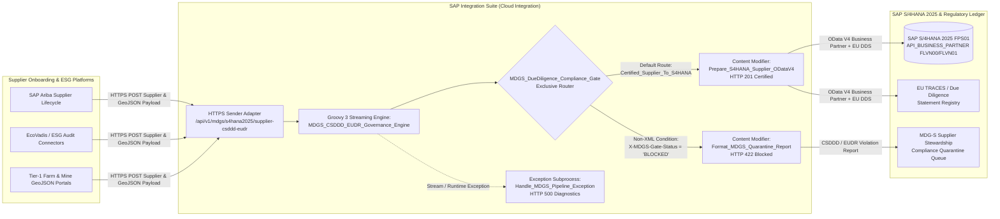
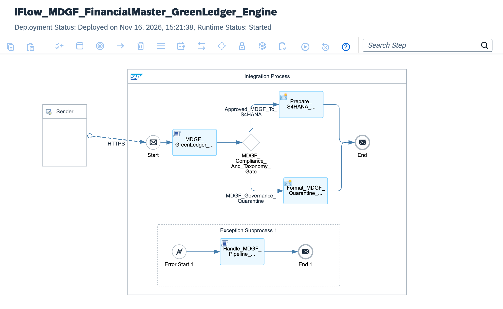

# SAP S/4HANA 2025 MDG-S Supplier CSDDD & EUDR Geo-Traceability Mesh

[-008FD3?style=for-the-badge&logo=sap&logoColor=white)](https://help.sap.com/docs/cloud-integration)
[](https://api.sap.com/)
[](https://commission.europa.eu/)
[](https://groovy-lang.org/)
[](https://spockframework.org/)

## Executive Overview

Under the **European Union Corporate Sustainability Due Diligence Directive (EU CSDDD 2024/1760)** and the **EU Deforestation Regulation (EUDR 2023/1115)**, enterprises onboarding raw-material and industrial suppliers in 2026–2027 must verify human-rights/environmental due diligence audits and plot-level **WGS84 geolocation polygons** before placing regulated commodities onto the EU market or activating purchasing roles (`FLVN00` / `FLVN01`) in **SAP S/4HANA 2025**.

Allowing unverified supplier records from external onboarding portals or SAP Ariba to enter the ERP core creates regulatory customs blocks, audit liabilities, and fragmented vendor master data. This repository delivers a production-grade **SAP Cloud Integration (CPI)** and **SAP MDG-S** pre-ingestion governance gate that validates **ISO 17442 LEI** check digits, enforces **CSDDD** audit thresholds, verifies closed **RFC 7946 GeoJSON** rings, and mints a tamper-evident **SHA-256 Due Diligence Statement (DDS)** alongside canonical **SAP S/4HANA 2025 OData V4 (`API_BUSINESS_PARTNER`)** payloads.

---

## End-to-End Architecture Flow



## SAP Cloud Integration (CPI) BPMN2 Integration Flow



---

## Core Architectural Capabilities

### 1. Mathematical ISO 17442 Legal Entity Identifier (LEI) Verification
Validates 20-character alphanumeric global **LEI** codes using full **ISO 17442 Mod-97-10** arithmetic (`BigInteger.mod(97) == 1`) to guarantee cryptographic entity uniqueness across cross-border customs and financial ledgers.

### 2. EU CSDDD (Directive 2024/1760) ESG Audit & Human-Rights Gate
Enforces mandatory corporate sustainability due diligence thresholds prior to vendor activation:
- Blocks suppliers scoring below the `75.0` ESG audit benchmark (`CSDDD_AUDIT_SCORE_DEFICIT`).
- Rejects entities with unresolved critical human-rights or environmental findings (`CriticalHumanRightsFindings > 0`).
- Verifies active audit validity against the current runtime date via `java.time.LocalDate`.

### 3. EUDR (Regulation 2023/1115) WGS84 GeoJSON Polygon Verification
Inspects every production plot in `EudrGeoPlots` against **RFC 7946** spatial integrity rules:
- Enforces closed polygon rings (`coords.first() == coords.last()`) with at least 4 coordinate pairs.
- Validates strict **WGS84** coordinate bounds (`Longitude ∈ [-180.0, 180.0]`, `Latitude ∈ [-90.0, 90.0]`).

### 4. Clean Core S/4HANA 2025 Supplier OData V4 & SHA-256 DDS Minting
Approved suppliers are transformed into canonical **SAP S/4HANA 2025 `API_BUSINESS_PARTNER`** deep-insert structures provisioning Purchasing (`FLVN00`) and Financial Accounting (`FLVN01`) roles, paired with a deterministic 64-character **SHA-256 Due Diligence Statement (`DDS-EU-...`)** fingerprint (`X-MDGS-Traceability-Hash`).

---

## BPMN2 Integration Flow Architecture

| Step | Component Type | Artifact / Step Name | Technical Configuration & Responsibility |
| :--- | :--- | :--- | :--- |
| **1** | **Sender Adapter** | `HTTPS` | Endpoint: `/api/v1/mdgs/s4hana2025/supplier-csddd-eudr`, Role-Based Auth (`ESBMessaging.send`). |
| **2** | **Groovy Script 1** | `MDGS_CSDDD_EUDR_Governance_Engine` | Streams JSON via `java.io.Reader`, validates ISO 17442 LEI, CSDDD audit score/expiry, and EUDR WGS84 polygons. |
| **3** | **Exclusive Router** | `MDGS_DueDiligence_Compliance_Gate` | Evaluates `X-MDGS-Gate-Status`. Default route forwards certified suppliers; non-XML condition `${header.X-MDGS-Gate-Status} = 'BLOCKED'` routes violations. |
| **4a** | **Content Modifier** | `Prepare_S4HANA_Supplier_ODataV4` | Sets `Content-Type: application/json` and `CamelHttpResponseCode: 201` for S/4HANA 2025 Business Partner ingestion. |
| **4b** | **Content Modifier** | `Format_MDGS_Quarantine_Report` | Sets `Content-Type: application/json` and `CamelHttpResponseCode: 422` for MDG-S Stewardship quarantine. |
| **5** | **Exception Subprocess** | `Handle_MDGS_Pipeline_Exception` | Captures `CamelExceptionCaught` runtime faults and returns structured `HTTP 500` JSON diagnostics. |

---

## Payload Contracts & Runtime Verification

### Scenario A: Certified EUDR & CSDDD Supplier (`HTTP 201 Certified`)

**Inbound Request (`POST /http/api/v1/mdgs/s4hana2025/supplier-csddd-eudr`):**
```json
{
  "SupplierLegalName": "Rheinische Agrar & Rohstoff GmbH",
  "Country": "DE",
  "LEI": "529900T8BM49AURSDO55",
  "CommodityHsCode": "18010000",
  "CsdddAuditScore": 91.5,
  "CriticalHumanRightsFindings": 0,
  "AuditValidUntil": "2027-06-30",
  "EudrGeoPlots": [
    {
      "PlotId": "PLOT-BR-PA-0041",
      "PolygonCoordinates": [
        [-48.4902, -1.4558],
        [-48.4850, -1.4558],
        [-48.4850, -1.4610],
        [-48.4902, -1.4558]
      ]
    }
  ]
}
```

**Outbound S/4HANA 2025 OData V4 + EU DDS Payload (`HTTP 201`):**
```json
{
  "@odata.context": "$metadata#A_BusinessPartner/$entity",
  "BusinessPartnerCategory": "2",
  "BusinessPartnerFullName": "Rheinische Agrar & Rohstoff GmbH",
  "BusinessPartnerGrouping": "BP02",
  "LegalEntityIdentifier": "529900T8BM49AURSDO55",
  "DueDiligenceFingerprint": "4d9a2e1c8b7f6035a1c9e4f7b2d5e8a1c3f6b9d2e5a8c1f4b7d0e3a6c9f2b5d8",
  "to_BusinessPartnerRole": [
    { "BusinessPartnerRole": "FLVN00" },
    { "BusinessPartnerRole": "FLVN01" }
  ],
  "to_BusinessPartnerAddress": [
    { "Country": "DE" }
  ],
  "EuDueDiligenceStatement_DDS": {
    "DdsReferenceId": "DDS-EU-4D9A2E1C8B7F",
    "VerifiedAt": "2026-11-16T14:41:16Z",
    "CommodityHsCode": "18010000",
    "CsdddAuditScore": 91.5,
    "ValidatedGeoPlotCount": 1,
    "ComplianceStatus": "CLEARED_FOR_EU_CUSTOMS_AND_S4HANA"
  }
}
```

---

### Scenario B: Unclosed EUDR Polygon & CSDDD Audit Breach (`HTTP 422 Blocked`)

**Inbound Request:**
```json
{
  "SupplierLegalName": "Opaque Timber Exports Ltd",
  "Country": "BR",
  "LEI": "529900T8BM49AURSDO99",
  "CommodityHsCode": "44071100",
  "CsdddAuditScore": 58.0,
  "CriticalHumanRightsFindings": 2,
  "AuditValidUntil": "2025-12-31",
  "EudrGeoPlots": [
    {
      "PlotId": "PLOT-UNCLOSED-99",
      "PolygonCoordinates": [
        [-54.1200, -3.2100],
        [-54.1100, -3.2100],
        [-54.1100, -3.2200],
        [-54.1250, -3.2250]
      ]
    }
  ]
}
```

**Outbound MDG-S Quarantine Report (`HTTP 422`):**
```json
{
  "status": "QUARANTINED_CSDDD_EUDR_HOLD",
  "regulations": ["EU_CSDDD_2024_1760", "EU_EUDR_2023_1115", "ISO_17442_LEI"],
  "timestamp": "2026-11-16T14:45:02Z",
  "supplierLegalName": "Opaque Timber Exports Ltd",
  "lei": "529900T8BM49AURSDO99",
  "ddsTraceabilitySha256": "8e1c4f7a2d9b6035e1a9c4f7b2d5e8a1c3f6b9d2e5a8c1f4b7d0e3a6c9f2b5d8",
  "violations": [
    "INVALID_ISO17442_LEI: Failed Mod-97-10 check-digit verification for LEI [529900T8BM49AURSDO99].",
    "CSDDD_AUDIT_SCORE_DEFICIT: Supplier ESG score 58.0 is below mandatory 75.0 threshold.",
    "CSDDD_HUMAN_RIGHTS_VIOLATION: Detected 2 unresolved critical human-rights/environmental findings.",
    "CSDDD_AUDIT_EXPIRED: Due diligence audit expired on [2025-12-31].",
    "EUDR_UNCLOSED_POLYGON_RING: Plot [PLOT-UNCLOSED-99] first coordinate [-54.1200, -3.2100] must equal last coordinate [-54.1250, -3.2250]."
  ]
}
```

---

## Local Test-Driven Development (Spock Framework)

All Groovy 3 `Reader`-streamed validation rules, ISO 17442 LEI Mod-97-10 check-digit verification, and RFC 7946 WGS84 polygon checks are verified locally via **Gradle** and **Spock Framework 2.3**:

```bash
gradle test --info
```

### Verified Test Specifications (`MdgsCsdddEudrValidatorSpec.groovy`)
- `Should certify compliant supplier with valid ISO 17442 LEI, CSDDD audit, and closed EUDR GeoJSON polygon`
- `Should block supplier failing ISO 17442 LEI Mod-97-10 check-digit or CSDDD ESG audit threshold`
- `Should block supplier with unclosed EUDR WGS84 GeoJSON polygon ring`

---

## Repository Structure

```text
sap-cpi-mdg-csddd-eudr-supplier-traceability-mesh/
├── artifacts/
│   └── IFlow_MDGS_Supplier_CSDDD_EUDR_Validator.zip          # Exported SAP CPI BPMN2 package
├── docs/
│   └── adr/
│       └── 001-mdgs-csddd-eudr-supplier-due-diligence-gating.md
├── src/
│   ├── main/
│   │   └── groovy/
│   │       ├── MDGS_CSDDD_EUDR_Governance_Engine.groovy      # Groovy 3 streaming MDG-S & EUDR validator
│   │       └── Handle_MDGS_Pipeline_Exception.groovy         # Structured HTTP 500 error handler
│   └── test/
│       └── groovy/
│           ├── com/sap/gateway/ip/core/customdev/util/
│           │   └── Message.groovy                            # SAP CPI Message stub (Reader-enabled)
│           └── MdgsCsdddEudrValidatorSpec.groovy             # Spock Framework TDD unit tests
├── build.gradle                                              # Groovy 3 & Spock 2.3 build descriptor
├── iflow-bpmn2-diagram.png                                   # SAP CPI BPMN2 flow screenshot
└── README.md
```

---

**Author:** Željko Popov  
*Integration & SAP S/4HANA Clean Core Architect*
